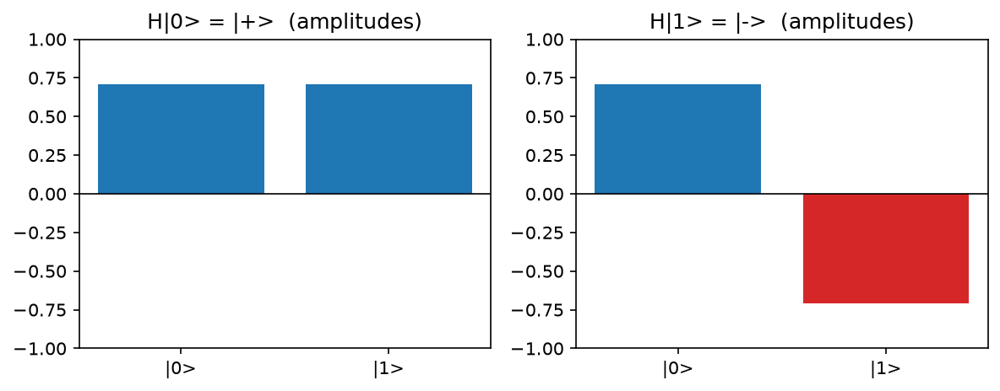
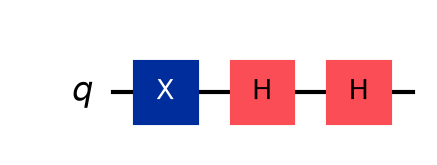
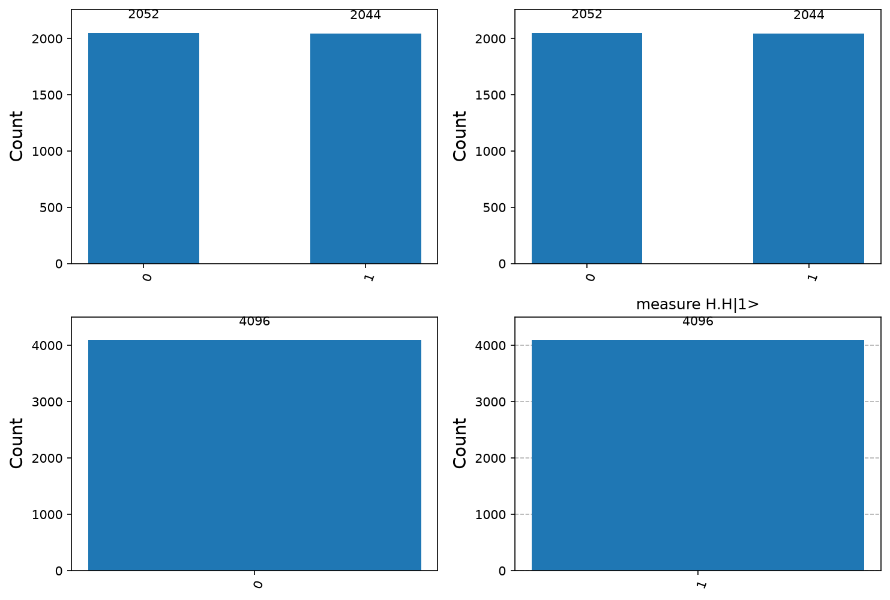
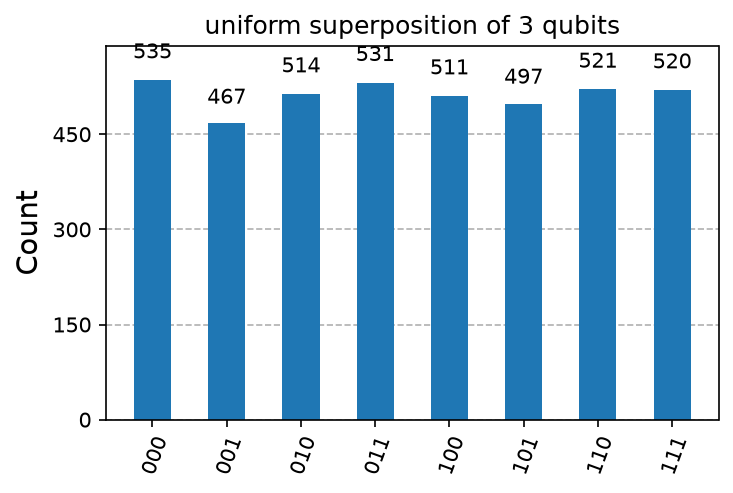

# 01. Hadamard Gate, Superposition and Interference

**Intuition (no prerequisites).** A normal bit is 0 or 1. A qubit can be a blend of both. The Hadamard gate turns a definite bit into a 50/50 blend. Applied twice, the two paths recombine and the original bit returns, because quantum numbers can cancel each other. That cancelling is where every quantum speedup comes from.

**Formal definition.** The Hadamard gate is the unitary H = (1/√2)[[1, 1], [1, -1]], Hermitian with H = H† and H² = I.

**Formulas**
- H|0> = (|0> + |1>)/√2 = |+>
- H|1> = (|0> - |1>)/√2 = |->
- General qubit: |ψ> = α|0> + β|1>, with |α|² + |β|² = 1.
- P(0) = |α|², P(1) = |β|²
- H^⊗n |0...0> = (1/√(2^n)) Σ_x |x>
- H^⊗n |x> = (1/√(2^n)) Σ_z (-1)^(x·z) |z>

**Key observation.** |+> and |-> give identical measurement statistics, so the sign is invisible. A second H turns that sign into a deterministic outcome: H|+> = |0> and H|-> = |1>. This is interference.

**Applications.** First step of nearly every algorithm; quantum random number generators.

---

<details>
<summary><strong>Click to view Qiskit Implementation</strong></summary>

```python
import sys
import pathlib

sys.path.append(str(pathlib.Path(__file__).resolve().parents[2]))
import numpy as np
import matplotlib.pyplot as plt
from qiskit import QuantumCircuit
from qiskit.quantum_info import Statevector
from qlab import counts, out, save_circuit, save_grid


def one_h(start):
    qc = QuantumCircuit(1)
    if start:
        qc.x(0)
    qc.h(0)
    return qc


def two_h(start):
    qc = QuantumCircuit(1)
    if start:
        qc.x(0)
    qc.h(0)
    qc.h(0)
    return qc


def uniform(n):
    qc = QuantumCircuit(n)
    qc.h(range(n))
    return qc


def measured(qc):
    m = qc.copy()
    m.measure_all()
    return m


def save_amps(path):
    fig, axs = plt.subplots(1, 2, figsize=(8, 3.2))
    for ax, s, name in zip(axs, (0, 1), ("H|0> = |+>", "H|1> = |->")):
        amp = Statevector(one_h(s)).data.real
        ax.bar(["|0>", "|1>"], amp, color=["tab:blue" if a > 0 else "tab:red" for a in amp])
        ax.axhline(0, color="k", lw=0.8)
        ax.set_ylim(-1, 1)
        ax.set_title(name + "  (amplitudes)")
    fig.tight_layout()
    fig.savefig(path, dpi=150, bbox_inches="tight")
    plt.close(fig)


def main():
    d = out(__file__)
    for s in (0, 1):
        print(f"H|{s}> amplitudes:", np.round(Statevector(one_h(s)).data, 4))
    print("H.H|0> amplitudes:", np.round(Statevector(two_h(0)).data, 4))
    print("H.H|1> amplitudes:", np.round(Statevector(two_h(1)).data, 4))
    u = Statevector(uniform(3))
    print("H^3|000> amplitudes:", np.round(u.data.real, 4))
    items = [
        ("measure H|0>", counts(measured(one_h(0)))),
        ("measure H|1>", counts(measured(one_h(1)))),
        ("measure H.H|0>", counts(measured(two_h(0)))),
        ("measure H.H|1>", counts(measured(two_h(1)))),
    ]
    for t, c in items:
        print(t, dict(sorted(c.items())))
    save_grid(items, d / "interference_histograms.png")
    save_amps(d / "amplitudes.png")
    save_circuit(two_h(1), d / "circuit.png")
    save_grid([("uniform superposition of 3 qubits", counts(measured(uniform(3))))], d / "uniform3.png", cols=1)


if __name__ == "__main__":
    main()
```

</details>

<details>
<summary><strong>Click to view Verified Simulator Output & Plots</strong></summary>

```text
H|0> amplitudes: [0.7071+0.j 0.7071+0.j]
H|1> amplitudes: [ 0.7071+0.j -0.7071+0.j]
H.H|0> amplitudes: [1.+0.j 0.+0.j]
H.H|1> amplitudes: [0.+0.j 1.+0.j]
H^3|000> amplitudes: [0.3536 0.3536 0.3536 0.3536 0.3536 0.3536 0.3536 0.3536]
measure H|0> {'0': 2052, '1': 2044}
measure H|1> {'0': 2052, '1': 2044}
measure H.H|0> {'0': 4096}
measure H.H|1> {'1': 4096}
```









</details>
