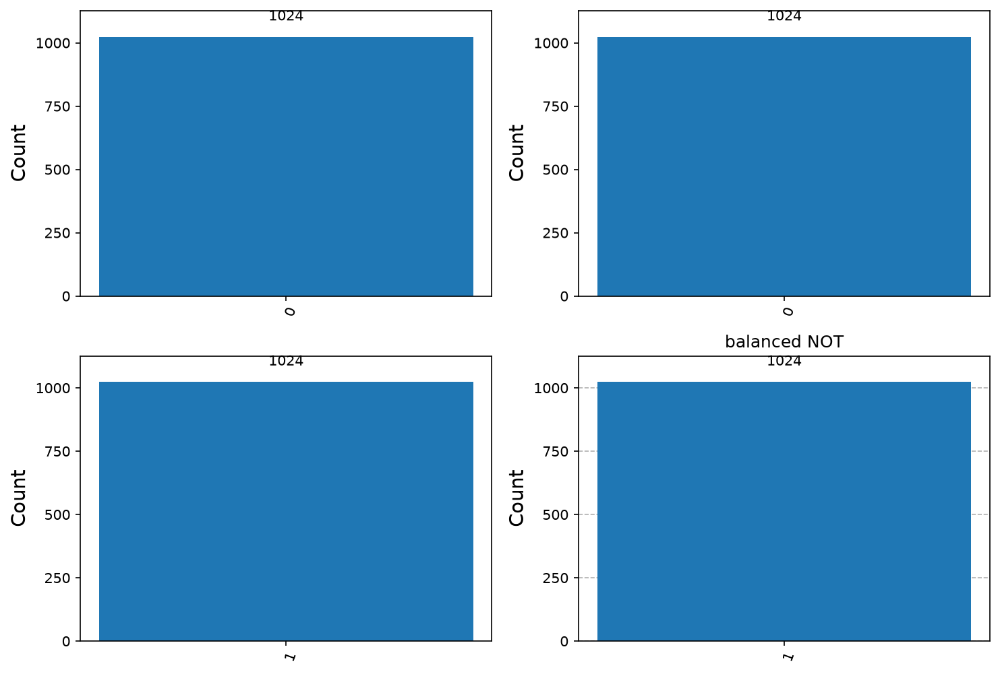
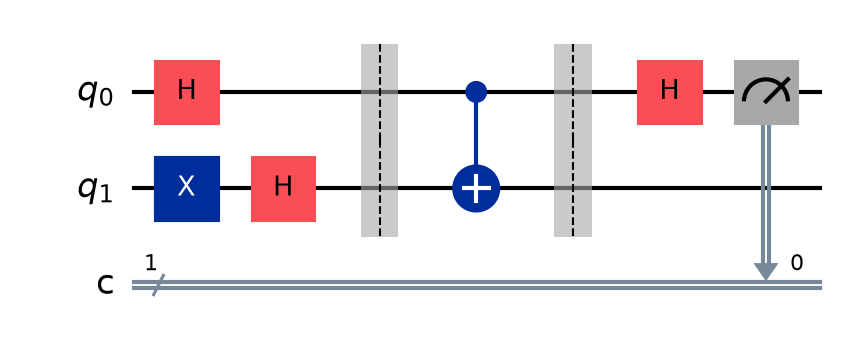
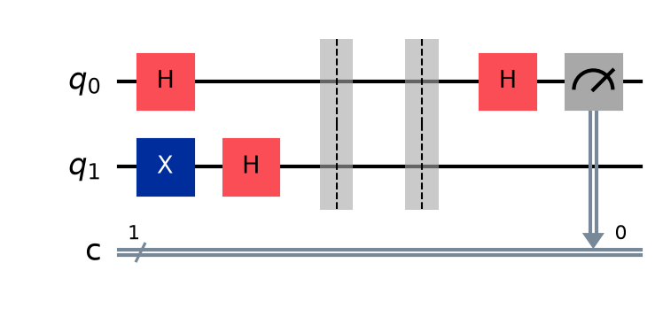

# 02. Deutsch's Algorithm

**Intuition.** A hidden function takes one bit in and gives one bit out. You must decide whether it ignores its input (constant) or really depends on it (balanced). Classically you must evaluate it twice. A quantum computer asks once, about both inputs at the same time, and reads the answer from an interference pattern.

**Problem.** Given an oracle f: {0,1} → {0,1} promised to be constant (f(0) = f(1)) or balanced (f(0) ≠ f(1)), decide which using the fewest queries.

**Oracle.** U_f |x>|y> = |x>|y ⊕ f(x)>

**Derivation (formulas)**
1. |ψ0> = |0>|1>
2. |ψ1> = [(|0>+|1>)/√2] ⊗ [(|0>-|1>)/√2]
3. Phase kickback: U_f |x>(|0>-|1>)/√2 = (-1)^f(x) |x>(|0>-|1>)/√2
4. |ψ2> = [((-1)^f(0)|0> + (-1)^f(1)|1>)/√2] ⊗ [(|0>-|1>)/√2]
5. Apply H to qubit 1. If constant, the result is ±|0>. If balanced, it is ±|1>.
6. Measure qubit 1. Outcome 0 means constant; outcome 1 means balanced.

**Complexity.** Classical: 2 queries. Quantum: 1 query, deterministic.

**Note on history.** Deutsch (1985) introduced the idea. The deterministic one-query form is due to Deutsch-Jozsa (1992) and Cleve et al. (1998).

**Applications.** The standard first example of quantum advantage. Its phase-kickback trick is reused in Bernstein-Vazirani, Simon, Shor, and QPE.

---

<details>
<summary><strong>Click to view Qiskit Implementation</strong></summary>

```python
import sys
import pathlib

sys.path.append(str(pathlib.Path(__file__).resolve().parents[2]))
from qiskit import QuantumCircuit
from qlab import counts, out, save_circuit, save_grid

ORACLES = {
    "constant 0": [],
    "constant 1": [("x", 1)],
    "balanced identity": [("cx", 0, 1)],
    "balanced NOT": [("cx", 0, 1), ("x", 1)],
}


def oracle(ops):
    qc = QuantumCircuit(2)
    for op in ops:
        getattr(qc, op[0])(*op[1:])
    return qc


def deutsch(ops):
    qc = QuantumCircuit(2, 1)
    qc.x(1)
    qc.h([0, 1])
    qc.barrier()
    qc.compose(oracle(ops), inplace=True)
    qc.barrier()
    qc.h(0)
    qc.measure(0, 0)
    return qc


def verdict(c):
    return "CONSTANT" if c.get("0", 0) > c.get("1", 0) else "BALANCED"


def main():
    d = out(__file__)
    items = []
    for name, ops in ORACLES.items():
        c = counts(deutsch(ops), shots=1024)
        print(f"{name:18s} -> {dict(c)} -> {verdict(c)}")
        items.append((name, c))
    save_grid(items, d / "all_oracles.png")
    save_circuit(deutsch(ORACLES["balanced identity"]), d / "circuit_balanced.png")
    save_circuit(deutsch(ORACLES["constant 0"]), d / "circuit_constant.png")


if __name__ == "__main__":
    main()
```

</details>

<details>
<summary><strong>Click to view Verified Simulator Output & Plots</strong></summary>

```text
constant 0         -> {'0': 1024} -> CONSTANT
constant 1         -> {'0': 1024} -> CONSTANT
balanced identity  -> {'1': 1024} -> BALANCED
balanced NOT       -> {'1': 1024} -> BALANCED
```







</details>
