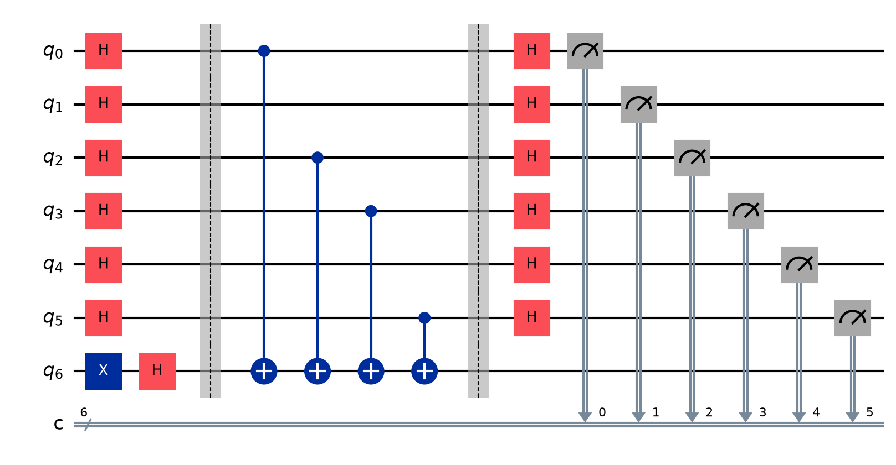
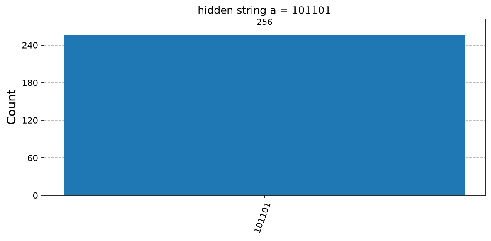
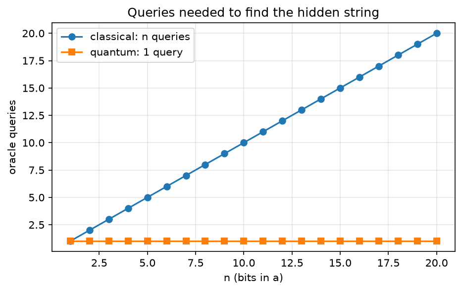

# 03. Bernstein-Vazirani Algorithm

**Intuition.** A secret n-bit code a is hidden inside a box. The box answers a·x (the XOR of the bits of a selected by x). Classically you learn one bit of a per question, so n questions. A quantum computer reads the whole code with one question.

**Problem.** Given f(x) = a·x (mod 2) = a1x1 ⊕ ... ⊕ anxn, find the hidden string a.

**Derivation (formulas)**
1. Start: |0>^n |1>
2. After H on all qubits: (1/√(2^n)) Σ_x |x> ⊗ (|0>-|1>)/√2
3. After oracle (phase kickback): (1/√(2^n)) Σ_x (-1)^(a·x) |x> ⊗ (|0>-|1>)/√2
4. Apply H^⊗n using H^⊗n|x> = (1/√(2^n)) Σ_z (-1)^(x·z)|z>. Every term cancels except z = a.
5. Final state: |a> ⊗ |->. Measuring the first n qubits gives a with probability 1.

**Complexity.** Classical: n queries. Quantum: 1 query.

**Applications.** Teaches the general n-qubit phase-kickback pattern; the same structure appears in learning hidden linear structure.

---

<details>
<summary><strong>Click to view Qiskit Implementation</strong></summary>

```python
import sys
import pathlib

sys.path.append(str(pathlib.Path(__file__).resolve().parents[2]))
import numpy as np
from qiskit import QuantumCircuit
from qlab import counts, out, save_circuit, save_curve, save_hist


def oracle(a):
    n = len(a)
    qc = QuantumCircuit(n + 1)
    for i, bit in enumerate(a[::-1]):
        if bit == "1":
            qc.cx(i, n)
    return qc


def bv(a):
    n = len(a)
    qc = QuantumCircuit(n + 1, n)
    qc.x(n)
    qc.h(range(n + 1))
    qc.barrier()
    qc.compose(oracle(a), inplace=True)
    qc.barrier()
    qc.h(range(n))
    qc.measure(range(n), range(n))
    return qc


def recover(a):
    c = counts(bv(a), shots=256)
    return max(c, key=c.get), c


def main():
    d = out(__file__)
    rng = np.random.default_rng(3)
    for n in (3, 6, 10):
        a = "".join(map(str, rng.integers(0, 2, n)))
        found, c = recover(a)
        print(f"n={n:2d} secret={a} found={found} one query, outcomes={len(c)} ok={a == found}")
    a = "101101"
    found, c = recover(a)
    save_hist(c, d / "histogram.png", f"hidden string a = {a}")
    save_circuit(bv(a), d / "circuit.png")
    ns = np.arange(1, 21)
    save_curve(
        [("classical: n queries", ns, ns, "o-"), ("quantum: 1 query", ns, np.ones_like(ns), "s-")],
        d / "queries.png",
        "Queries needed to find the hidden string",
        "n (bits in a)",
        "oracle queries",
    )


if __name__ == "__main__":
    main()
```

</details>

<details>
<summary><strong>Click to view Verified Simulator Output & Plots</strong></summary>

```text
n= 3 secret=100 found=100 one query, outcomes=1 ok=True
n= 6 secret=001110 found=001110 one query, outcomes=1 ok=True
n=10 secret=0001000110 found=0001000110 one query, outcomes=1 ok=True
```







</details>
