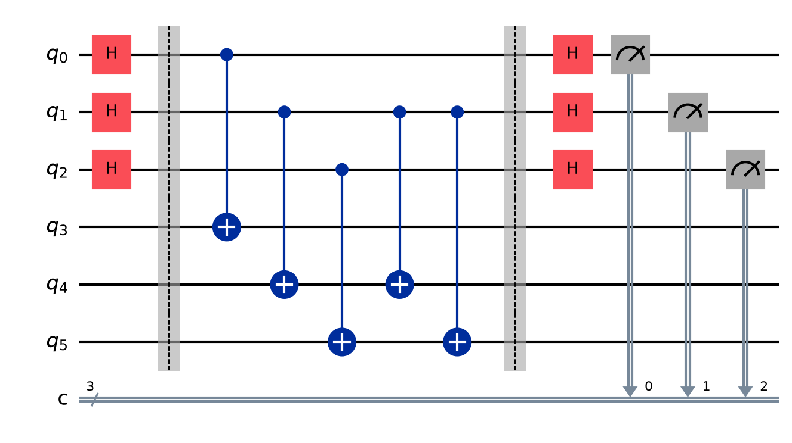
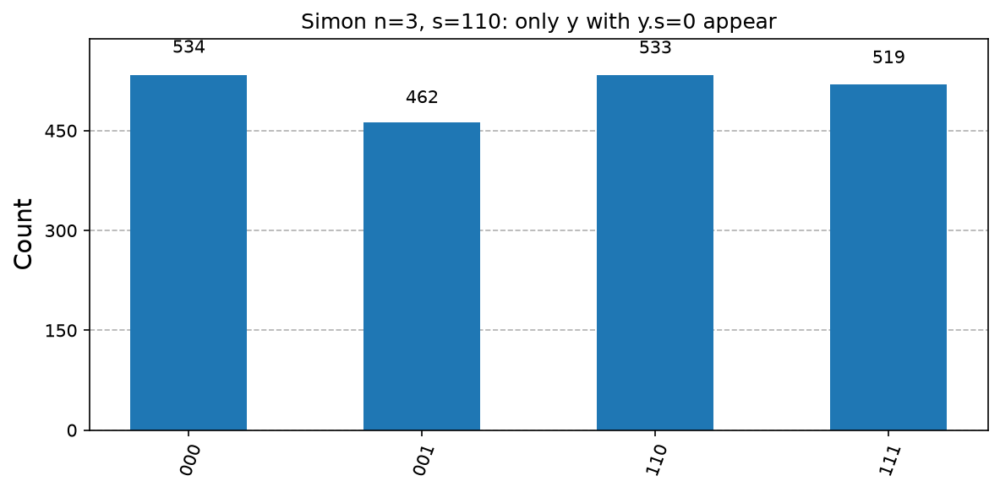
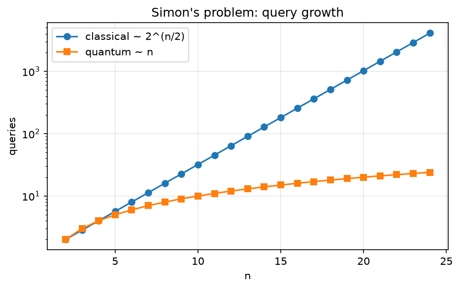

# 04. Simon's Algorithm

**Intuition.** A box maps n-bit inputs to n-bit outputs, and secretly pairs up inputs: x and x⊕s always give the same output. Finding a collision classically needs about 2^(n/2) tries (birthday paradox). The quantum circuit instead produces random strings that are each guaranteed to be "perpendicular" to s. A handful of them pin s down.

**Problem.** Given f: {0,1}^n → {0,1}^n with f(x) = f(y) if and only if y = x ⊕ s for a hidden s ≠ 0, find s.

**Derivation (formulas)**
1. (1/√(2^n)) Σ_x |x>|0>, after H^⊗n on the first register
2. (1/√(2^n)) Σ_x |x>|f(x)>, after the oracle
3. Measuring the second register leaves (|x0> + |x0⊕s>)/√2
4. After H^⊗n, the amplitude of |y> is proportional to (-1)^(x0·y) [1 + (-1)^(s·y)]
5. This is nonzero only if s·y = 0 (mod 2). Each run returns a random y with y·s = 0.
6. Repeat about n-1 times, then solve the linear system over GF(2) for s.

**Complexity.** Classical: Θ(2^(n/2)) queries. Quantum: O(n) queries.

**Applications.** The first exponential query separation, and the direct precursor of Shor; basis of the abelian hidden-subgroup framework; quantum attacks on some symmetric constructions.

**Code note.** The solver brute-forces all nonzero candidates consistent with the equations, which is fine for small n; use Gaussian elimination over GF(2) at scale.

---

<details>
<summary><strong>Click to view Qiskit Implementation</strong></summary>

```python
import sys
import pathlib

sys.path.append(str(pathlib.Path(__file__).resolve().parents[2]))
import numpy as np
from qiskit import QuantumCircuit
from qlab import counts, out, save_circuit, save_curve, save_hist


def oracle(s):
    n = len(s)
    s = s[::-1]
    qc = QuantumCircuit(2 * n)
    for q in range(n):
        qc.cx(q, n + q)
    if "1" in s:
        i = s.index("1")
        for q in range(n):
            if s[q] == "1":
                qc.cx(i, n + q)
    return qc


def simon(s):
    n = len(s)
    qc = QuantumCircuit(2 * n, n)
    qc.h(range(n))
    qc.barrier()
    qc.compose(oracle(s), inplace=True)
    qc.barrier()
    qc.h(range(n))
    qc.measure(range(n), range(n))
    return qc


def dot(a, b):
    return bin(a & b).count("1") % 2


def solve(ys, n):
    return [c for c in range(1, 2**n) if all(dot(c, y) == 0 for y in ys)]


def main():
    d = out(__file__)
    s = "110"
    n = len(s)
    c = counts(simon(s), shots=2048)
    ys = sorted({int(k, 2) for k in c})
    print("hidden s =", s)
    print("measured y:", [format(y, f"0{n}b") for y in ys])
    print("all y.s = 0:", all(dot(y, int(s, 2)) == 0 for y in ys))
    print("candidates consistent with every y:", [format(x, f"0{n}b") for x in solve(ys, n)])
    save_hist(c, d / "histogram.png", f"Simon n={n}, s={s}: only y with y.s=0 appear")
    save_circuit(simon(s), d / "circuit.png")
    ns = np.arange(2, 25)
    save_curve(
        [("classical ~ 2^(n/2)", ns, 2 ** (ns / 2), "o-"), ("quantum ~ n", ns, ns, "s-")],
        d / "queries.png",
        "Simon's problem: query growth",
        "n",
        "queries",
        logy=True,
    )


if __name__ == "__main__":
    main()
```

</details>

<details>
<summary><strong>Click to view Verified Simulator Output & Plots</strong></summary>

```text
hidden s = 110
measured y: ['000', '001', '110', '111']
all y.s = 0: True
candidates consistent with every y: ['110']
```







</details>
