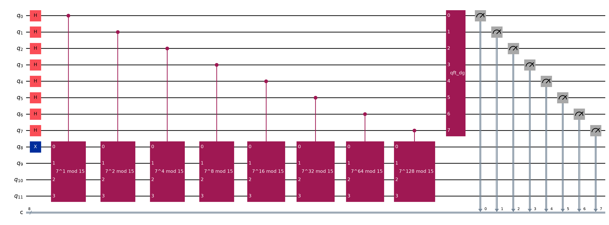
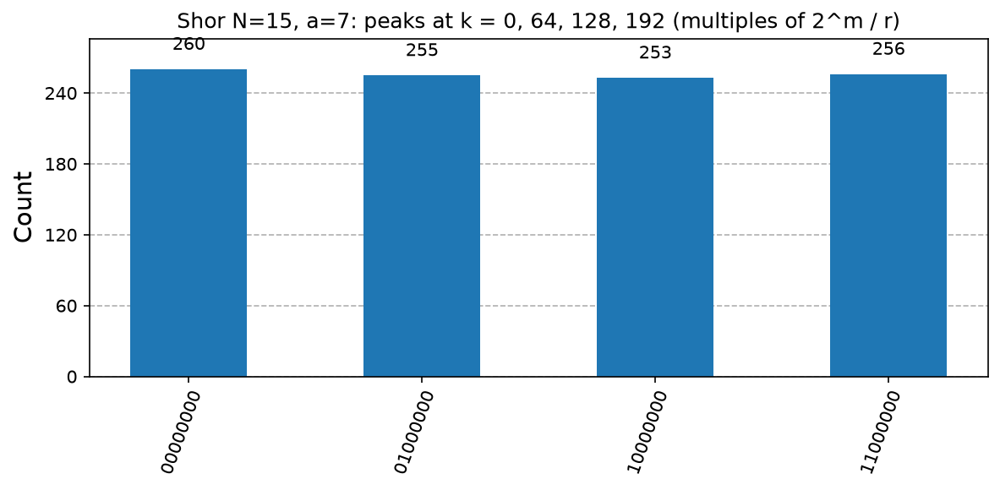

# 05. Shor's Algorithm

**Intuition.** Factoring a big number is hard because nobody knows a fast way to find its factors. Shor noticed it reduces to finding the repeat length of the sequence a^x mod N, and a quantum computer can find a repeat length quickly by making all the values interfere. Multiplying and dividing the repeat length into the number then reveals the factors.

**Problem.** Given a composite integer N, find a nontrivial factor.

**Reduction to period finding.** Choose a coprime to N and let f(x) = a^x mod N. Let r be the smallest r > 0 with a^r ≡ 1 (mod N).

**Algorithm (formulas)**
1. Pick random a with 1 < a < N. If gcd(a, N) > 1, a factor is found.
2. Build (1/√Q) Σ_x |x>|0>, with Q = 2^m.
3. Modular exponentiation: (1/√Q) Σ_x |x>|a^x mod N>
4. Apply the inverse QFT. QFT|x> = (1/√Q) Σ_k e^(2πi·xk/Q) |k>. The register peaks at k ≈ j·Q/r for integer j.
5. Continued fractions on k/Q recover r.
6. If r is odd or a^(r/2) ≡ -1 (mod N), retry with a new a.
7. Otherwise gcd(a^(r/2) - 1, N) and gcd(a^(r/2) + 1, N) give nontrivial factors.

**Worked example (N = 15, a = 7).** 7^x mod 15 = 7, 4, 13, 1, 7, ... so r = 4. Then 7² mod 15 = 4, gcd(3, 15) = 3 and gcd(5, 15) = 5.

**Complexity.** Quantum: O((log N)² log log N log log log N). Classical best known: exp(O((log N)^(1/3) (log log N)^(2/3))).

**Applications.** Breaks RSA, Diffie-Hellman, and elliptic-curve cryptography, which drives the migration to post-quantum cryptography.

**Code note.** The modular multiplication circuits are hard-coded for N = 15 (the standard textbook construction), so the quantum circuit is real but small-scale. Larger N needs general modular arithmetic circuits.

---

<details>
<summary><strong>Click to view Qiskit Implementation</strong></summary>

```python
import sys
import pathlib

sys.path.append(str(pathlib.Path(__file__).resolve().parents[2]))
from math import gcd
from fractions import Fraction
from qiskit import QuantumCircuit
from qiskit.circuit.library import QFTGate
from qlab import counts, out, save_circuit, save_hist

N = 15
SWAPS = {
    2: [(2, 3), (1, 2), (0, 1)],
    7: [(1, 2), (2, 3), (0, 3)],
    8: [(0, 1), (1, 2), (2, 3)],
    11: [(1, 3), (0, 2)],
    13: [(2, 3), (1, 2), (0, 1)],
}


def mult(a, p):
    qc = QuantumCircuit(4)
    for _ in range(p % 4):
        for i, j in SWAPS[a]:
            qc.swap(i, j)
        if a in (7, 11, 13):
            qc.x([0, 1, 2, 3])
    g = qc.to_gate()
    g.name = f"{a}^{p} mod 15"
    return g.control()


def shor_circuit(a, m):
    qc = QuantumCircuit(m + 4, m)
    qc.h(range(m))
    qc.x(m)
    for j in range(m):
        qc.append(mult(a, 2**j), [j] + list(range(m, m + 4)))
    qc.append(QFTGate(m).inverse(), range(m))
    qc.measure(range(m), range(m))
    return qc


def factors(a, k, m):
    r = Fraction(k, 2**m).limit_denominator(N).denominator
    if r % 2 or pow(a, r, N) != 1 or pow(a, r // 2, N) == N - 1:
        return r, None
    h = pow(a, r // 2, N)
    return r, sorted({gcd(h - 1, N), gcd(h + 1, N)} - {1, N})


def attempt(a, m=8):
    c = counts(shor_circuit(a, m), shots=1024)
    for key in sorted(c, key=c.get, reverse=True):
        r, f = factors(a, int(key, 2), m)
        if f:
            return c, int(key, 2), r, f
    return c, None, None, None


def main():
    d = out(__file__)
    m = 8
    for a in (7, 11, 13, 2, 8):
        c, k, r, f = attempt(a, m)
        print(f"a={a:2d} measured k={k} phase={k}/{2**m} period r={r} factors of {N}: {f}")
    c, *_ = attempt(7, m)
    save_hist(c, d / "histogram.png", "Shor N=15, a=7: peaks at k = 0, 64, 128, 192 (multiples of 2^m / r)")
    save_circuit(shor_circuit(7, m), d / "circuit.png")


if __name__ == "__main__":
    main()
```

</details>

<details>
<summary><strong>Click to view Verified Simulator Output & Plots</strong></summary>

```text
a= 7 measured k=192 phase=192/256 period r=4 factors of 15: [3, 5]
a=11 measured k=128 phase=128/256 period r=2 factors of 15: [3, 5]
a=13 measured k=192 phase=192/256 period r=4 factors of 15: [3, 5]
a= 2 measured k=192 phase=192/256 period r=4 factors of 15: [3, 5]
a= 8 measured k=192 phase=192/256 period r=4 factors of 15: [3, 5]
```





</details>
