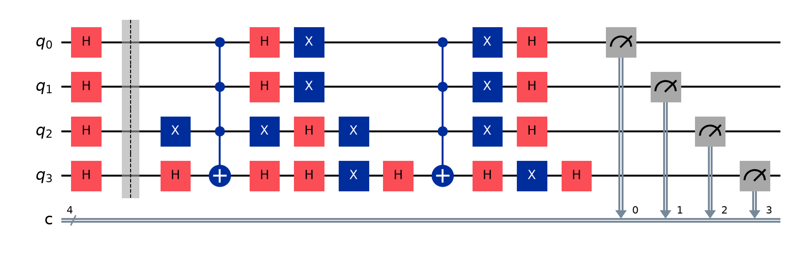
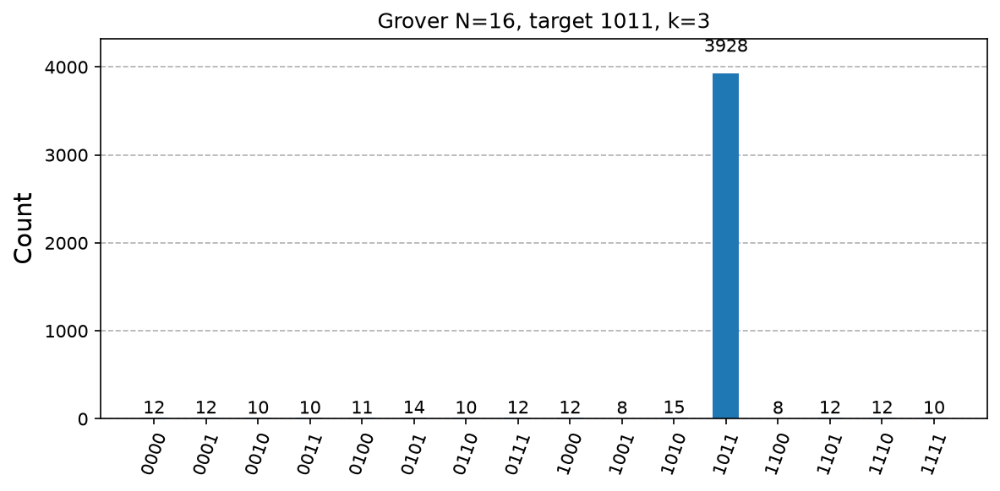
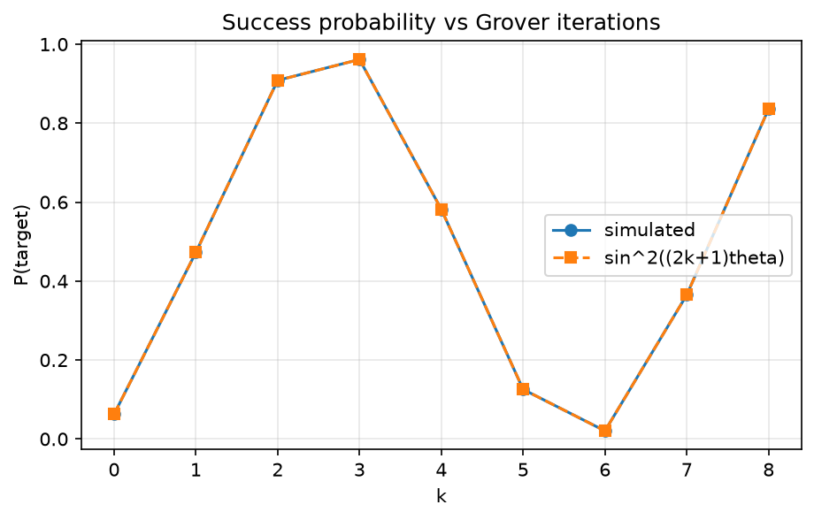

# 06. Grover's Algorithm

**Intuition.** Finding one marked item in an unsorted list of N items normally means checking about N/2 of them. Grover's algorithm starts with all items equally likely, then repeatedly nudges probability toward the marked one, like pushing a swing at the right moment. After about √N pushes, the marked item is almost certain. Push too long and it swings away again.

**Problem.** Given an oracle marking one item w among N = 2^n, find w.

**Operators (formulas)**
- Oracle: O_f|x> = -|x> if x = w, else |x>
- Diffusion: D = 2|s><s| - I, with |s> = (1/√N) Σ_x |x>
- Grover iteration: G = D·O_f
- Geometry: sin θ = 1/√N. After k iterations, the state sits at angle (2k+1)θ from the unmarked axis.
- Success probability: P(w) = sin²((2k+1)θ)
- Optimal iterations: k ≈ (π/4)√N

**Complexity.** Classical: O(N). Quantum: O(√N), provably optimal for unstructured search (BBBV theorem).

**Applications.** Speeds up any brute-force search (SAT, key search), and generalises to amplitude amplification and estimation. Against AES-256, Grover reduces effective strength to about 128 bits.

---

<details>
<summary><strong>Click to view Qiskit Implementation</strong></summary>

```python
import sys
import pathlib

sys.path.append(str(pathlib.Path(__file__).resolve().parents[2]))
import numpy as np
from qiskit import QuantumCircuit
from qiskit.quantum_info import Statevector
from qlab import counts, out, save_circuit, save_curve, save_hist


def oracle(t):
    n = len(t)
    qc = QuantumCircuit(n)
    z = [i for i, b in enumerate(t[::-1]) if b == "0"]
    if z:
        qc.x(z)
    qc.h(n - 1)
    qc.mcx(list(range(n - 1)), n - 1)
    qc.h(n - 1)
    if z:
        qc.x(z)
    return qc


def diffuser(n):
    qc = QuantumCircuit(n)
    qc.h(range(n))
    qc.x(range(n))
    qc.h(n - 1)
    qc.mcx(list(range(n - 1)), n - 1)
    qc.h(n - 1)
    qc.x(range(n))
    qc.h(range(n))
    return qc


def grover(t, k, meas=True):
    n = len(t)
    qc = QuantumCircuit(n, n if meas else 0)
    qc.h(range(n))
    for _ in range(k):
        qc.barrier()
        qc.compose(oracle(t), inplace=True)
        qc.compose(diffuser(n), inplace=True)
    if meas:
        qc.measure(range(n), range(n))
    return qc


def prob(t, k):
    return Statevector(grover(t, k, False)).probabilities_dict().get(t, 0.0)


def main():
    d = out(__file__)
    t = "1011"
    n = len(t)
    N = 2**n
    k = int(np.pi / 4 * np.sqrt(N))
    print(f"N={N} target={t} optimal iterations k={k}")
    c = counts(grover(t, k), shots=4096)
    print("top outcome:", max(c, key=c.get), "P =", round(c[t] / 4096, 4))
    theta = np.arcsin(1 / np.sqrt(N))
    ks = np.arange(0, 9)
    sim = [prob(t, int(i)) for i in ks]
    thy = np.sin((2 * ks + 1) * theta) ** 2
    for i in ks:
        print(f"k={i} simulated={sim[i]:.4f} theory={thy[i]:.4f}")
    save_hist(c, d / "histogram.png", f"Grover N={N}, target {t}, k={k}")
    save_curve(
        [("simulated", ks, sim, "o-"), ("sin^2((2k+1)theta)", ks, thy, "s--")],
        d / "probability_vs_k.png",
        "Success probability vs Grover iterations",
        "k",
        "P(target)",
    )
    save_circuit(grover(t, 1), d / "circuit.png")


if __name__ == "__main__":
    main()
```

</details>

<details>
<summary><strong>Click to view Verified Simulator Output & Plots</strong></summary>

```text
N=16 target=1011 optimal iterations k=3
top outcome: 1011 P = 0.959
k=0 simulated=0.0625 theory=0.0625
k=1 simulated=0.4727 theory=0.4727
k=2 simulated=0.9084 theory=0.9084
k=3 simulated=0.9613 theory=0.9613
k=4 simulated=0.5817 theory=0.5817
k=5 simulated=0.1255 theory=0.1255
k=6 simulated=0.0204 theory=0.0204
k=7 simulated=0.3649 theory=0.3649
k=8 simulated=0.8361 theory=0.8361
```







</details>
