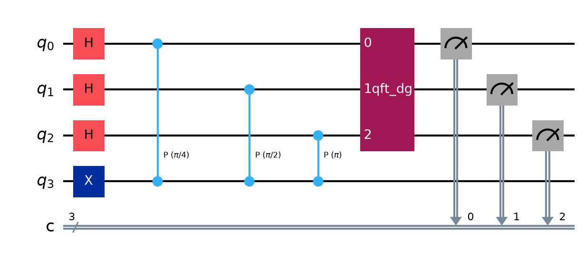
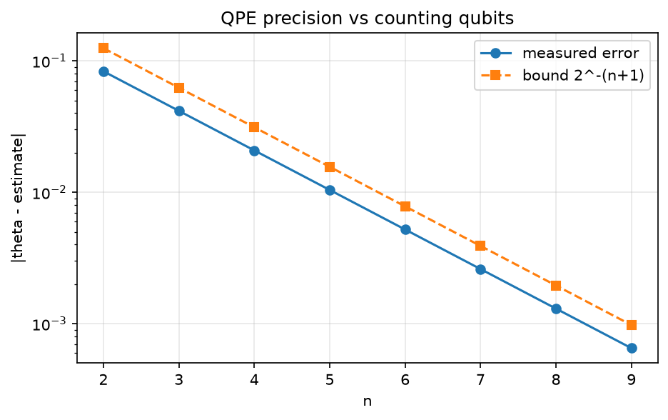
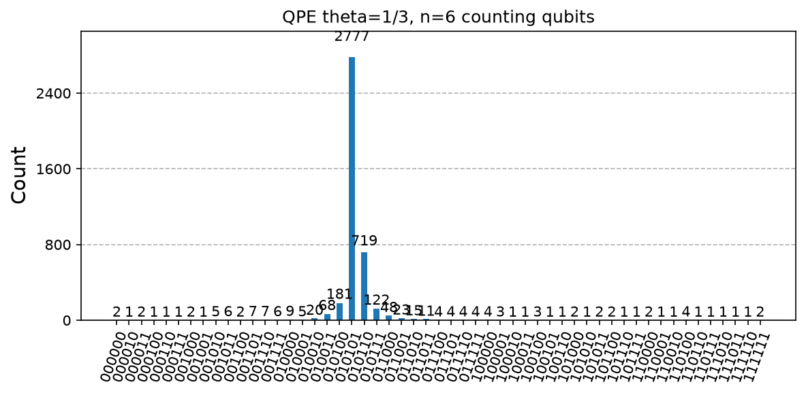

# 07. Quantum Phase Estimation (QPE)

**Intuition.** Some quantum operations leave a state unchanged except for a twist (a phase). QPE measures that twist as a binary fraction. It is not an end-user algorithm; it is the measuring tool inside Shor, HHL, and quantum chemistry.

**Problem.** Given a unitary U and an eigenvector |ψ> with U|ψ> = e^(2πiθ)|ψ>, estimate θ ∈ [0, 1) to n bits.

**Derivation (formulas)**
1. (1/√(2^n)) Σ_k |k>|ψ>, after H on n counting qubits
2. Controlled-U^(2^j) from counting qubit j gives (1/√(2^n)) Σ_k e^(2πiθk) |k>|ψ>
3. Inverse QFT maps this register to |θ̃>
4. Measure to get θ̃ ≈ k/2^n

**Precision.** If θ = k/2^n exactly, the result is deterministic. Otherwise the nearest n-bit value is returned with probability at least 4/π², and the error is at most 2^-(n+1) for that nearest value.

**Applications.** Core of Shor, HHL, and Hamiltonian-simulation energy estimation; generalised by quantum singular value transformation.

---

<details>
<summary><strong>Click to view Qiskit Implementation</strong></summary>

```python
import sys
import pathlib

sys.path.append(str(pathlib.Path(__file__).resolve().parents[2]))
import numpy as np
from qiskit import QuantumCircuit
from qiskit.circuit.library import QFTGate
from qlab import counts, out, save_circuit, save_curve, save_hist


def qpe(theta, n):
    qc = QuantumCircuit(n + 1, n)
    qc.x(n)
    qc.h(range(n))
    for j in range(n):
        qc.cp(2 * np.pi * theta * 2**j, j, n)
    qc.append(QFTGate(n).inverse(), range(n))
    qc.measure(range(n), range(n))
    return qc


def estimate(theta, n):
    c = counts(qpe(theta, n), shots=4096)
    k = int(max(c, key=c.get), 2)
    return k / 2**n, c


def main():
    d = out(__file__)
    e, c = estimate(1 / 8, 3)
    print(f"theta=1/8 n=3 -> estimate {e} (exact, probability {c.get('001', 0) / 4096:.3f})")
    e, c = estimate(1 / 3, 6)
    print(f"theta=1/3 n=6 -> estimate {e:.6f} error {abs(e - 1 / 3):.6f}")
    save_hist(c, d / "histogram.png", "QPE theta=1/3, n=6 counting qubits")
    save_circuit(qpe(1 / 8, 3), d / "circuit.png")
    ns = np.arange(2, 10)
    err = [abs(estimate(1 / 3, int(n))[0] - 1 / 3) for n in ns]
    for n, x in zip(ns, err):
        print(f"n={n} error={x:.6f} bound 2^-(n+1)={2.0 ** -(n + 1):.6f}")
    save_curve(
        [("measured error", ns, err, "o-"), ("bound 2^-(n+1)", ns, 2.0 ** -(ns + 1), "s--")],
        d / "error_vs_n.png",
        "QPE precision vs counting qubits",
        "n",
        "|theta - estimate|",
        logy=True,
    )


if __name__ == "__main__":
    main()
```

</details>

<details>
<summary><strong>Click to view Verified Simulator Output & Plots</strong></summary>

```text
theta=1/8 n=3 -> estimate 0.125 (exact, probability 1.000)
theta=1/3 n=6 -> estimate 0.328125 error 0.005208
n=2 error=0.083333 bound 2^-(n+1)=0.125000
n=3 error=0.041667 bound 2^-(n+1)=0.062500
n=4 error=0.020833 bound 2^-(n+1)=0.031250
n=5 error=0.010417 bound 2^-(n+1)=0.015625
n=6 error=0.005208 bound 2^-(n+1)=0.007812
n=7 error=0.002604 bound 2^-(n+1)=0.003906
n=8 error=0.001302 bound 2^-(n+1)=0.001953
n=9 error=0.000651 bound 2^-(n+1)=0.000977
```







</details>
