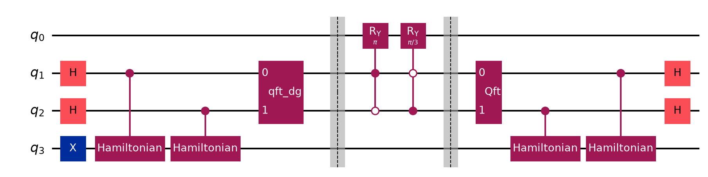
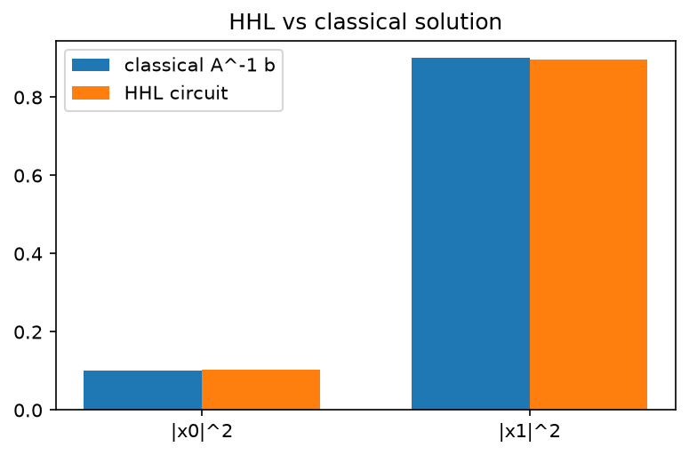

# 08. HHL Algorithm (Quantum Linear Systems)

**Intuition.** To solve A·x = b, HHL splits b into the "natural directions" (eigenvectors) of A, divides each part by its eigenvalue, and recombines. The answer comes out as a quantum state, not a list of numbers, so it is useful only when you need a summary of x (an expectation value), not every entry.

**Problem.** Given Hermitian A (N×N, s-sparse, condition number κ) and |b>, prepare |x> ∝ A^-1|b>.

**Derivation (formulas)**
1. |b> = Σ_j β_j |u_j>, with A|u_j> = λ_j|u_j>
2. QPE with U = e^(iAt): Σ_j β_j |λ_j>|u_j>
3. Controlled rotation on an ancilla: Σ_j β_j |λ_j>|u_j> (√(1 - C²/λ_j²)|0> + (C/λ_j)|1>)
4. Uncompute QPE and post-select the ancilla on |1>: |x> ∝ Σ_j (β_j/λ_j)|u_j> = A^-1|b>

**Complexity.** Quantum: O(log N · s² · κ² / ε). Classical conjugate gradient: roughly O(N · s · κ). The speedup is exponential in N but comes with caveats: efficient state loading, sparse A, small κ, and only global properties of x are readable.

**Toy instance in the code.** A = [[1, -1/3], [-1/3, 1]], b = (0, 1). Eigenvalues are 2/3 and 4/3. With t = 3π/4 the phases are exactly 1/4 and 1/2, so a 2-qubit clock encodes them exactly (k = 1 and 2), and the rotation angle is 2·arcsin(1/k).

**Applications.** Foundation of many quantum machine learning speedup proposals and PDE solvers.

---

<details>
<summary><strong>Click to view Qiskit Implementation</strong></summary>

```python
import sys
import pathlib

sys.path.append(str(pathlib.Path(__file__).resolve().parents[2]))
import numpy as np
import matplotlib.pyplot as plt
from qiskit import QuantumCircuit
from qiskit.circuit.library import HamiltonianGate, QFTGate, RYGate
from qlab import counts, out, save_circuit

A = np.array([[1, -1 / 3], [-1 / 3, 1]])
B = np.array([0.0, 1.0])
T = 3 * np.pi / 4


def cu(j, s):
    return HamiltonianGate(A, -s * T * 2**j).control(1)


def forward(qc):
    qc.h([1, 2])
    for j in range(2):
        qc.append(cu(j, 1), [1 + j, 3])
    qc.append(QFTGate(2).inverse(), [1, 2])


def backward(qc):
    qc.append(QFTGate(2), [1, 2])
    for j in reversed(range(2)):
        qc.append(cu(j, -1), [1 + j, 3])
    qc.h([1, 2])


def rotate(qc):
    for k in (1, 2):
        qc.append(RYGate(2 * np.arcsin(1 / k)).control(2, ctrl_state=k), [1, 2, 0])


def hhl():
    qc = QuantumCircuit(4)
    qc.x(3)
    forward(qc)
    qc.barrier()
    rotate(qc)
    qc.barrier()
    backward(qc)
    return qc


def run(shots=40000):
    qc = hhl()
    qc.measure_all()
    c = counts(qc, shots=shots)
    keep = {k: v for k, v in c.items() if k[-1] == "1" and k[1:3] == "00"}
    tot = sum(keep.values())
    p = [sum(v for k, v in keep.items() if k[0] == b) / tot for b in "01"]
    return p, tot / shots


def main():
    d = out(__file__)
    x = np.linalg.solve(A, B)
    pc = (x / np.linalg.norm(x)) ** 2
    pq, ok = run()
    print("eigenvalues of A:", np.round(np.linalg.eigvalsh(A), 4))
    print("classical solution x:", np.round(x, 4))
    print("classical |x_i|^2 normalised:", np.round(pc, 4))
    print("HHL postselected |x_i|^2   :", np.round(pq, 4))
    print("ancilla success probability:", round(ok, 4))
    fig, ax = plt.subplots(figsize=(6, 3.6))
    ax.bar(np.arange(2) - 0.18, pc, 0.36, label="classical A^-1 b")
    ax.bar(np.arange(2) + 0.18, pq, 0.36, label="HHL circuit")
    ax.set_xticks([0, 1], ["|x0|^2", "|x1|^2"])
    ax.legend()
    ax.set_title("HHL vs classical solution")
    fig.savefig(d / "solution.png", dpi=150, bbox_inches="tight")
    plt.close(fig)
    save_circuit(hhl(), d / "circuit.png")


if __name__ == "__main__":
    main()
```

</details>

<details>
<summary><strong>Click to view Verified Simulator Output & Plots</strong></summary>

```text
eigenvalues of A: [0.6667 1.3333]
classical solution x: [0.375 1.125]
classical |x_i|^2 normalised: [0.1 0.9]
HHL postselected |x_i|^2   : [0.1035 0.8965]
ancilla success probability: 0.628
```





</details>
