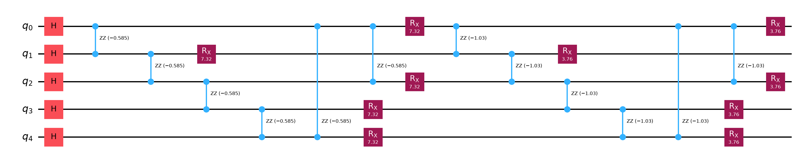
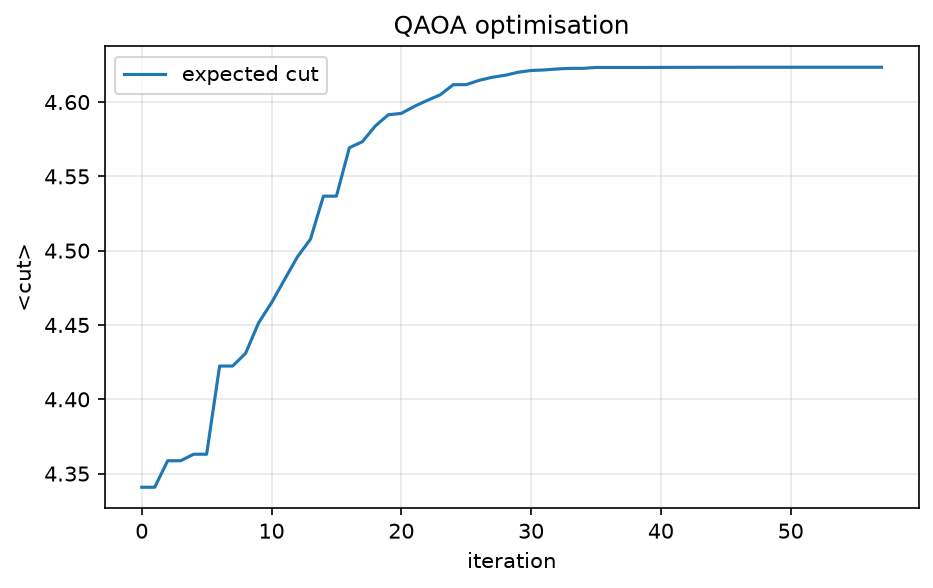
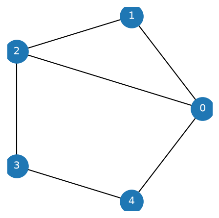
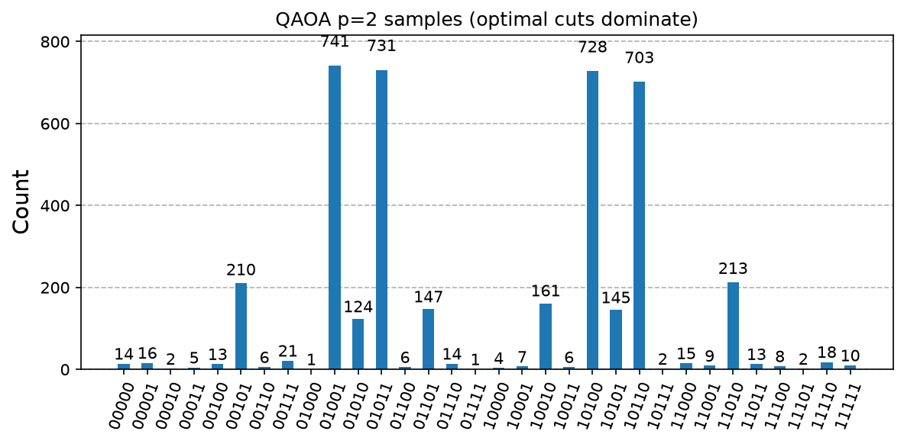

# 09. Quantum Approximate Optimization Algorithm (QAOA)

**Intuition.** Many real problems ask for the best choice among exponentially many (route planning, scheduling, splitting a network). QAOA encodes the problem as an energy landscape and alternates two moves: "reward good answers" and "shake things up". A classical computer tunes how strong each move is, and the quantum computer tests the result. It is built for today's noisy hardware.

**Problem (Max-Cut).** Split the vertices of a graph into two groups to maximise the number of edges between groups.

**Formulas**
- Cost Hamiltonian: Hc = Σ_{(i,j)∈E} (1 - Z_i Z_j)/2 (its expectation is the cut value, which we maximise)
- Mixer: Hb = Σ_i X_i
- Ansatz: |γ,β> = Π_{l=p..1} e^(-iβ_l Hb) e^(-iγ_l Hc) |+>^⊗n
- Objective: maximise <γ,β| Hc |γ,β>
- Hybrid loop: the quantum device prepares the state and estimates <Hc>; a classical optimiser (COBYLA) updates (γ, β).

**Depth trade-off.** Larger p gives a better approximation but a deeper, noisier circuit.

**Instance in the code.** 5 vertices, edges (0,1), (1,2), (2,3), (3,4), (4,0), (0,2); p = 2; best of 5 random restarts. Optimisation uses exact statevector expectations; final sampling uses the Aer simulator.

**Applications.** Max-Cut, graph partitioning, portfolio optimisation, routing, and scheduling; a leading NISQ-era candidate.

---

<details>
<summary><strong>Click to view Qiskit Implementation</strong></summary>

```python
import sys
import pathlib

sys.path.append(str(pathlib.Path(__file__).resolve().parents[2]))
import numpy as np
import matplotlib.pyplot as plt
from scipy.optimize import minimize
from qiskit import QuantumCircuit
from qiskit.quantum_info import Statevector
from qlab import counts, out, save_circuit, save_curve, save_hist

EDGES = [(0, 1), (1, 2), (2, 3), (3, 4), (4, 0), (0, 2)]
N = 5
P = 2


def cut(x):
    return sum(((x >> i) & 1) != ((x >> j) & 1) for i, j in EDGES)


CUTS = np.array([cut(x) for x in range(2**N)])


def ansatz(g, b, meas=False):
    qc = QuantumCircuit(N, N if meas else 0)
    qc.h(range(N))
    for l in range(P):
        for i, j in EDGES:
            qc.rzz(-g[l], i, j)
        qc.rx(2 * b[l], range(N))
    if meas:
        qc.measure(range(N), range(N))
    return qc


def energy(x):
    p = Statevector(ansatz(x[:P], x[P:])).probabilities()
    return -float(p @ CUTS)


def train(seed):
    h = []
    x0 = np.random.default_rng(seed).uniform(0, np.pi, 2 * P)
    r = minimize(energy, x0, method="COBYLA", options={"maxiter": 200}, callback=lambda v: h.append(-energy(v)))
    return r, h


def draw(path):
    ang = np.linspace(0, 2 * np.pi, N, endpoint=False)
    xy = np.c_[np.cos(ang), np.sin(ang)]
    fig, ax = plt.subplots(figsize=(3.6, 3.6))
    for i, j in EDGES:
        ax.plot(*zip(xy[i], xy[j]), "k-", lw=1)
    ax.scatter(*xy.T, s=500, c="tab:blue", zorder=3)
    for i, (x, y) in enumerate(xy):
        ax.text(x, y, i, ha="center", va="center", color="w", zorder=4)
    ax.axis("off")
    fig.savefig(path, dpi=150, bbox_inches="tight")
    plt.close(fig)


def main():
    d = out(__file__)
    runs = [train(s) for s in range(5)]
    r, h = min(runs, key=lambda t: t[0].fun)
    best = CUTS.max()
    print("max cut (brute force):", best)
    print("optimal gamma, beta:", np.round(r.x[:P], 4), np.round(r.x[P:], 4))
    print("expected cut:", round(-r.fun, 4), " approximation ratio:", round(-r.fun / best, 4))
    c = counts(ansatz(r.x[:P], r.x[P:], True), shots=4096)
    top = max(c, key=c.get)
    print("most frequent bitstring:", top, "cut value:", cut(int(top, 2)))
    good = sum(v for k, v in c.items() if cut(int(k, 2)) == best) / 4096
    print("probability of sampling an optimal cut:", round(good, 4))
    save_hist(c, d / "histogram.png", "QAOA p=2 samples (optimal cuts dominate)")
    save_curve([("expected cut", range(len(h)), h, "-")], d / "convergence.png", "QAOA optimisation", "iteration", "<cut>")
    save_circuit(ansatz(r.x[:P], r.x[P:]), d / "circuit.png")
    draw(d / "graph.png")


if __name__ == "__main__":
    main()
```

</details>

<details>
<summary><strong>Click to view Verified Simulator Output & Plots</strong></summary>

```text
max cut (brute force): 5
optimal gamma, beta: [0.5848 1.0285] [3.6589 1.8799]
expected cut: 4.6234  approximation ratio: 0.9247
most frequent bitstring: 01001 cut value: 5
probability of sampling an optimal cut: 0.7087
```









</details>
