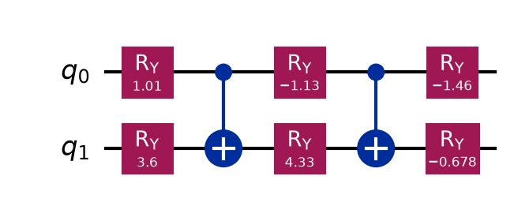
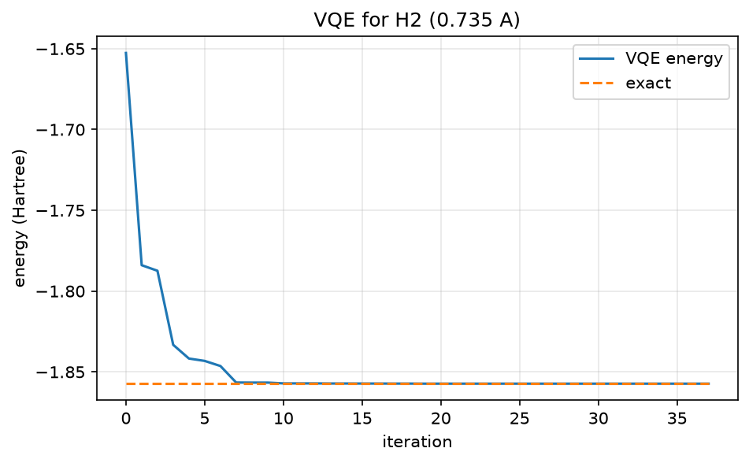
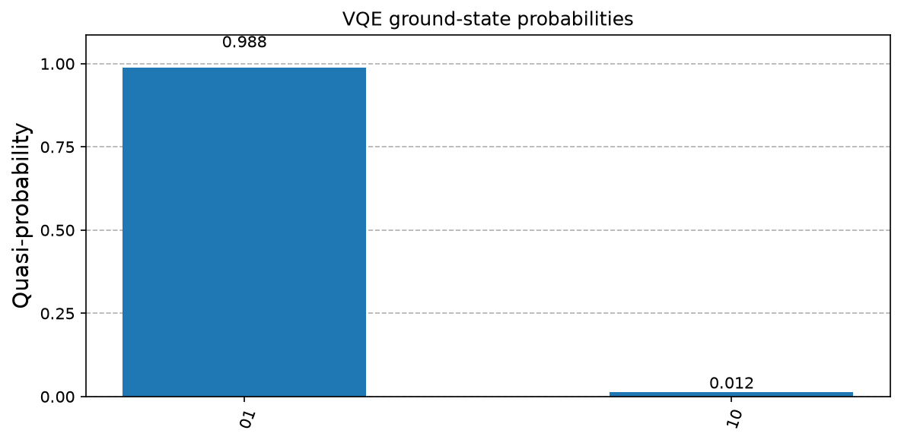

# 10. Variational Quantum Eigensolver (VQE)

**Intuition.** Nature settles into its lowest-energy state. VQE guesses a quantum state with adjustable knobs, measures its energy, and lets a classical optimiser turn the knobs downhill. The variational principle guarantees you can never dip below the true answer, so lower always means closer.

**Problem.** Find the ground-state energy E0 of a Hamiltonian H (here, molecular hydrogen).

**Formulas**
- Variational principle: <ψ(θ)|H|ψ(θ)> ≥ E0 for every normalised |ψ(θ)>
- Pauli decomposition: H = Σ_k c_k P_k, with P_k ∈ {I, X, Y, Z}^⊗n
- Energy: E(θ) = Σ_k c_k <P_k>
- Loop: prepare |ψ(θ)>, measure each <P_k>, sum classically, update θ, repeat until converged.

**H2 instance (0.735 Å, 2-qubit reduced form).** H = -1.0524 II + 0.3979 IZ - 0.3979 ZI - 0.0113 ZZ + 0.1809 XX (Hartree, electronic part). Total energy = electronic + nuclear repulsion 0.71997 Ha. The 6-parameter ansatz uses RY layers with two CNOTs, which spans all real 2-qubit states.

**Applications.** Molecular and materials energies, catalyst and drug design; the most widely run quantum chemistry algorithm on current hardware.

---

<details>
<summary><strong>Click to view Qiskit Implementation</strong></summary>

```python
import sys
import pathlib

sys.path.append(str(pathlib.Path(__file__).resolve().parents[2]))
import numpy as np
from scipy.optimize import minimize
from qiskit import QuantumCircuit
from qiskit.primitives import StatevectorEstimator
from qiskit.quantum_info import SparsePauliOp, Statevector
from qlab import out, save_circuit, save_curve, save_hist

H = SparsePauliOp.from_list(
    [
        ("II", -1.052373245772859),
        ("IZ", 0.39793742484318045),
        ("ZI", -0.39793742484318045),
        ("ZZ", -0.01128010425623538),
        ("XX", 0.18093119978423156),
    ]
)
NUC = 0.7199689944489797


def ansatz(t):
    qc = QuantumCircuit(2)
    qc.ry(t[0], 0)
    qc.ry(t[1], 1)
    qc.cx(0, 1)
    qc.ry(t[2], 0)
    qc.ry(t[3], 1)
    qc.cx(0, 1)
    qc.ry(t[4], 0)
    qc.ry(t[5], 1)
    return qc


def energy(t):
    r = StatevectorEstimator().run([(ansatz(t), H)]).result()
    return float(r[0].data.evs)


def main():
    d = out(__file__)
    exact = float(np.linalg.eigvalsh(H.to_matrix()).min())
    hist = []
    x0 = np.random.default_rng(1).uniform(-np.pi, np.pi, 6)
    r = minimize(energy, x0, method="COBYLA", options={"maxiter": 400}, callback=lambda v: hist.append(energy(v)))
    print("exact electronic energy :", round(exact, 6))
    print("VQE electronic energy   :", round(r.fun, 6))
    print("absolute error          :", f"{abs(r.fun - exact):.2e}")
    print("VQE total energy (+nuclear repulsion):", round(r.fun + NUC, 6))
    p = Statevector(ansatz(r.x)).probabilities_dict()
    save_hist({k: v for k, v in p.items() if v > 1e-6}, d / "state.png", "VQE ground-state probabilities")
    it = range(len(hist))
    save_curve(
        [("VQE energy", it, hist, "-"), ("exact", it, [exact] * len(hist), "--")],
        d / "convergence.png",
        "VQE for H2 (0.735 A)",
        "iteration",
        "energy (Hartree)",
    )
    save_circuit(ansatz(r.x), d / "circuit.png")


if __name__ == "__main__":
    main()
```

</details>

<details>
<summary><strong>Click to view Verified Simulator Output & Plots</strong></summary>

```text
exact electronic energy : -1.857275
VQE electronic energy   : -1.857275
absolute error          : 2.02e-10
VQE total energy (+nuclear repulsion): -1.137306
```







</details>
