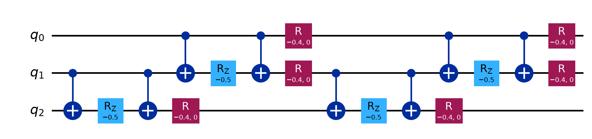
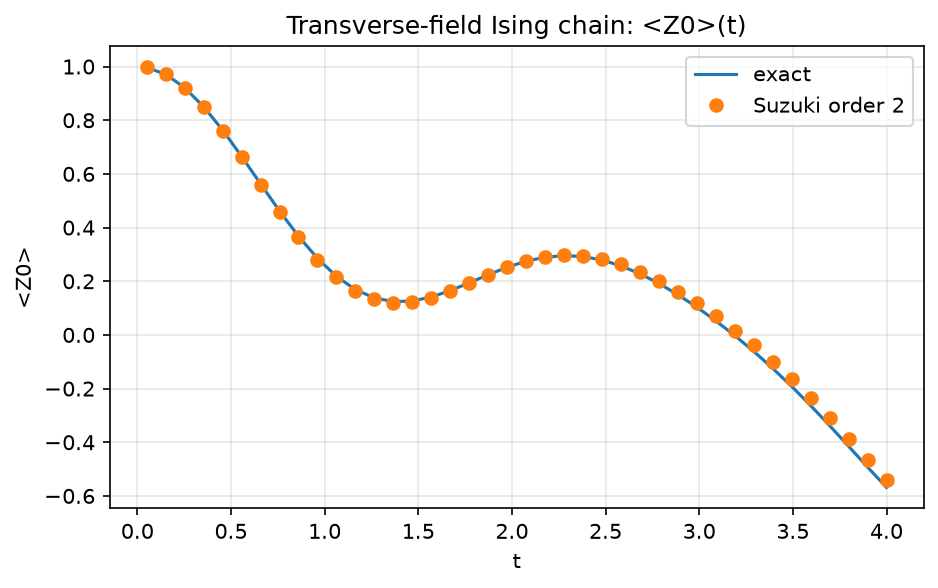
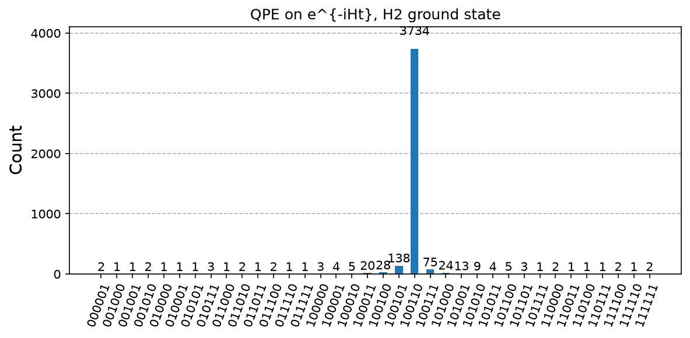
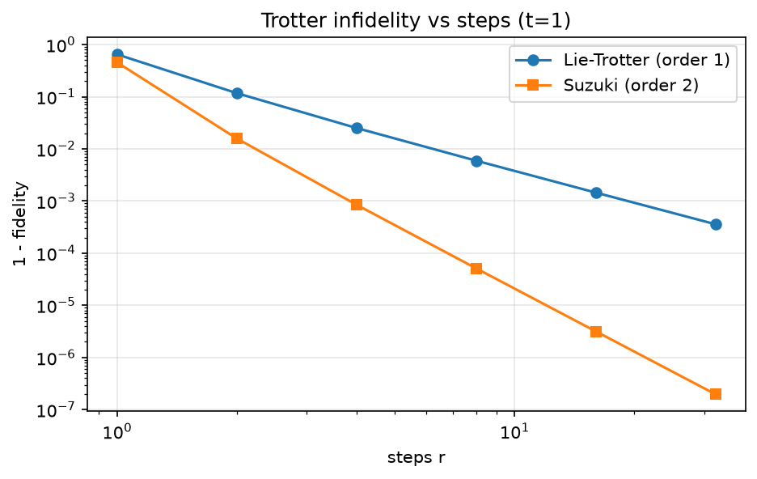

# 11. Hamiltonian Simulation and QPE Energy Estimation

**Intuition.** Feynman's original reason for quantum computers: to simulate quantum physics you need a quantum system. To advance a system through time you cut the evolution into tiny slices and apply each physical interaction in turn (Trotterization). Feeding that evolution into phase estimation then reads out the system's energies.

**Problem.** Given H and time t, implement |ψ(t)> = e^(-iHt)|ψ(0)>.

**Formulas**
- Lie-Trotter: e^(-iHt) ≈ (Π_k e^(-iH_k t/r))^r, per-step error O((t/r)² Σ_{j<k} ||[H_j, H_k]||), total error O(t²/r)
- Second-order (Suzuki) formula: total error O(t³/r²)
- Eigenstate phase: e^(-iHt)|E_j> = e^(-iE_j t)|E_j>
- QPE with U = e^(-iHt) returns φ with e^(2πiφ) = e^(-iE t), so **φ = -E·t/2π (mod 1)** and **E = -2πφ/t**, valid when |E|·t < 2π
- Energy resolution: 2π / (t · 2^n)

**Corrected sign.** Many texts write E = +2πφ/t with U = e^(-iHt); that has the wrong sign. The code uses the correct one.

**In the code.** Part A simulates a 3-qubit transverse-field Ising chain H = -Σ Z_i Z_{i+1} - 0.8 Σ X_i and compares Lie and Suzuki Trotter circuits with exact evolution. Part B runs QPE on the H2 Hamiltonian from chapter 10 using the exact unitary e^(-iHt) (instead of Trotterised) to isolate QPE accuracy, with t = 2 and n = 6.

**QPE vs VQE.** QPE gives energies limited only by n and Trotter error but needs deep, fault-tolerant circuits and a good eigenstate overlap. VQE uses shallow circuits but gives only a variational upper bound.

**Applications.** Chemistry and materials, nuclear and particle physics, and quantum field theory; the flagship long-term quantum application.

---

<details>
<summary><strong>Click to view Qiskit Implementation</strong></summary>

```python
import sys
import pathlib

sys.path.append(str(pathlib.Path(__file__).resolve().parents[2]))
import numpy as np
from scipy.linalg import expm
from qiskit import QuantumCircuit
from qiskit.circuit.library import HamiltonianGate, PauliEvolutionGate, QFTGate
from qiskit.circuit.library import StatePreparation
from qiskit.quantum_info import SparsePauliOp, Statevector
from qiskit.synthesis import LieTrotter, SuzukiTrotter
from qlab import counts, out, save_circuit, save_curve, save_hist

TFIM = SparsePauliOp.from_list([("ZZI", -1), ("IZZ", -1), ("XII", -0.8), ("IXI", -0.8), ("IIX", -0.8)])
H2 = SparsePauliOp.from_list(
    [
        ("II", -1.052373245772859),
        ("IZ", 0.39793742484318045),
        ("ZI", -0.39793742484318045),
        ("ZZ", -0.01128010425623538),
        ("XX", 0.18093119978423156),
    ]
)


def exact(t):
    v = np.zeros(8, complex)
    v[0] = 1
    return expm(-1j * np.asarray(TFIM.to_matrix(sparse=False)) * t) @ v


def trotter(t, r, order):
    syn = LieTrotter(reps=r) if order == 1 else SuzukiTrotter(order=2, reps=r)
    qc = QuantumCircuit(3)
    qc.append(PauliEvolutionGate(TFIM, time=t, synthesis=syn), range(3))
    return qc.decompose(reps=2)


def infid(t, r, order):
    s = Statevector(trotter(t, r, order)).data
    return 1 - abs(np.vdot(exact(t), s)) ** 2


def mag(v):
    return float(Statevector(v).expectation_value(SparsePauliOp("IIZ")).real)


def qpe_energy(n=6, t=2.0):
    w, v = np.linalg.eigh(H2.to_matrix())
    m = H2.to_matrix()
    qc = QuantumCircuit(n + 2, n)
    qc.append(StatePreparation(v[:, 0]), [n, n + 1])
    qc.h(range(n))
    for j in range(n):
        qc.append(HamiltonianGate(m, t * 2**j).control(1), [j, n, n + 1])
    qc.append(QFTGate(n).inverse(), range(n))
    qc.measure(range(n), range(n))
    c = counts(qc, shots=4096)
    k = int(max(c, key=c.get), 2)
    return -2 * np.pi * (k / 2**n) / t, w[0], c, qc


def main():
    d = out(__file__)
    rs = np.array([1, 2, 4, 8, 16, 32])
    e1 = [infid(1.0, int(r), 1) for r in rs]
    e2 = [infid(1.0, int(r), 2) for r in rs]
    for r, a, b in zip(rs, e1, e2):
        print(f"steps={r:2d} infidelity Lie={a:.2e} Suzuki2={b:.2e}")
    save_curve(
        [("Lie-Trotter (order 1)", rs, e1, "o-"), ("Suzuki (order 2)", rs, e2, "s-")],
        d / "trotter_error.png",
        "Trotter infidelity vs steps (t=1)",
        "steps r",
        "1 - fidelity",
        True,
        True,
    )
    ts = np.linspace(0.05, 4, 40)
    ex = [mag(exact(t)) for t in ts]
    tr = [mag(Statevector(trotter(t, int(np.ceil(6 * t)), 2)).data) for t in ts]
    save_curve(
        [("exact", ts, ex, "-"), ("Suzuki order 2", ts, tr, "o")],
        d / "dynamics.png",
        "Transverse-field Ising chain: <Z0>(t)",
        "t",
        "<Z0>",
    )
    est, ex_e, c, qc = qpe_energy()
    print(f"QPE energy estimate : {est:.4f}")
    print(f"exact ground energy : {ex_e:.4f}")
    print(f"resolution 2*pi/(t*2^n) = {2 * np.pi / (2 * 2**6):.4f}")
    save_hist(c, d / "qpe_energy.png", "QPE on e^{-iHt}, H2 ground state")
    save_circuit(trotter(0.5, 2, 1), d / "circuit.png")


if __name__ == "__main__":
    main()
```

</details>

<details>
<summary><strong>Click to view Verified Simulator Output & Plots</strong></summary>

```text
steps= 1 infidelity Lie=6.47e-01 Suzuki2=4.53e-01
steps= 2 infidelity Lie=1.17e-01 Suzuki2=1.58e-02
steps= 4 infidelity Lie=2.51e-02 Suzuki2=8.48e-04
steps= 8 infidelity Lie=5.93e-03 Suzuki2=5.11e-05
steps=16 infidelity Lie=1.45e-03 Suzuki2=3.17e-06
steps=32 infidelity Lie=3.59e-04 Suzuki2=1.98e-07
QPE energy estimate : -1.8653
exact ground energy : -1.8573
resolution 2*pi/(t*2^n) = 0.0491
```









</details>
